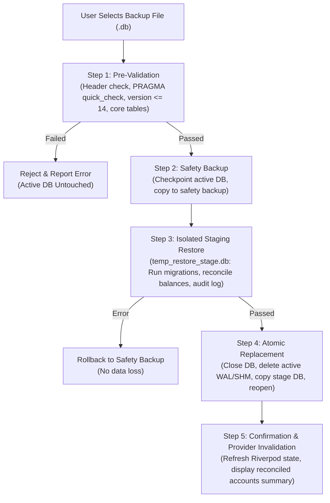

# Feature F08: Backup, Restore, Database Migration & Financial Balance Integrity

## 1. Executive Summary & Root Cause Analysis

### The Problem
When users exported a database backup from an existing Money Manager installation, upgraded their APK, and imported the `.db` file, account balances displayed incorrect values. In severe cases, opening balances were reset to ₹0 or reduced to only the net sum of logged transactions.

### Root Cause Identification
1. **Erasure of Opening Balances during Recalculation**:
   In legacy migrations and balance recalculation logic, `recalculateAllBalances` initialized every account's balance to `0` (`accountBalancesMinor[accId] = 0`), assuming that all balances derived exclusively from rows in `transaction_log`. However, accounts in Money Manager are created with an initial opening balance that is stored directly on the `account` record without creating an artificial transaction. When an imported database underwent migration, this function erased all historical opening balances.
2. **SQLite Write-Ahead Logging (WAL) Mode Consistency on Export**:
   SQLite on mobile platforms operates in WAL mode. Active transactions and balance updates reside in `money_manager.db-wal` until a checkpoint occurs. The legacy export simply copied `money_manager.db` without executing `PRAGMA wal_checkpoint(TRUNCATE)`, resulting in exported backups missing recent transactions and updated balances.
3. **Stale WAL Contamination on Restore**:
   The legacy restore copied the imported `.db` file directly over `money_manager.db` without deleting pre-existing `money_manager.db-wal` and `money_manager.db-shm` files. Upon database initialization, SQLite attempted to recover and replay stale WAL frames over the newly imported database, corrupting balances.
4. **Lack of Staging, Pre-Validation, and Safety Rollback**:
   The legacy restore overwrote the active database immediately before verifying SQLite integrity, schema compatibility, or foreign key validity. If the file was corrupted or from an incompatible schema, user data was irreversibly destroyed.

---

## 2. The 5-Step Staged Restoration Pipeline

To permanently resolve these defects, Feature F08 introduces a non-negotiable 5-step staged restoration pipeline in `BackupService`:

### Step 1: Pre-Validation
- Validates file existence and minimum size.
- Inspects SQLite header magic bytes (`SQLite format 3\0`).
- Opens in read-only mode and executes `PRAGMA quick_check;`.
- Checks `PRAGMA user_version`. If `user_version > 14`, the backup is safely rejected with a clear message requesting an application update.
- Confirms presence of core financial tables (`account`, `transaction_log`, `category`).

### Step 2: Safety Backup
- Before altering active state, issues `PRAGMA wal_checkpoint(TRUNCATE)` on the active database.
- Creates `money_manager_pre_restore_safety_backup.db` along with `-wal` and `-shm` copies.
- Guarantees complete rollback capability if subsequent operations encounter anomalies.

### Step 3: Isolated Staging Restore
- Restores the candidate backup into an isolated temporary database (`temp_restore_stage.db`).
- Executes schema migrations (v12 -> v13 -> v14) within the sandbox.
- Derives opening balances where previously unrecorded:
  $$\text{Opening Balance} = \text{Stored Balance} - \text{Net Transactions}$$
- Performs full balance reconciliation and records audit entries into `balance_audit_log`.
- Verifies foreign key constraints (`PRAGMA foreign_key_check`) and overall integrity (`PRAGMA integrity_check`).
- Issues `PRAGMA wal_checkpoint(TRUNCATE)` and closes the staging database.

### Step 4: Atomic Replacement
- Closes all active database connections via `AppDatabase.instance.close()`.
- Explicitly deletes active WAL (`money_manager.db-wal`) and SHM (`money_manager.db-shm`) files to eliminate stale frame replay.
- Copies `temp_restore_stage.db` over `money_manager.db`.
- Re-opens the active database connection via `AppDatabase.instance.database`.
- Deletes temporary staging files and cleans up the safety backup.

### Step 5: Provider Invalidation & Confirmation
- Re-reads and invalidates all Riverpod state notifiers:
  - `accountsProvider`
  - `transactionsProvider`
  - `categoriesProvider`
  - `budgetsProvider`
  - `savingsGoalsProvider`
  - `debtsProvider`
  - `transactionTemplatesProvider`
  - `authProvider`
- Displays a clear confirmation message to the user detailing the number of restored accounts, transactions, and reconciled balances.

---

## 3. Financial Balance Reconciliation Formulas

All monetary calculations adhere strictly to integer minor units (paise for INR).

### Regular Accounts (Bank, Cash, Savings, Wallet)
$$\text{Current Balance} = \text{Opening Balance} + \sum \text{Income} - \sum \text{Expense} - \sum \text{Outgoing Transfers} + \sum \text{Incoming Transfers} + \sum \text{Received Credit Card Payments}$$

- **Opening Balance**: Maintained explicitly in `initial_balance_minor`. For legacy databases where this column was absent, it is mathematically derived during migration:
  $$\text{initial\_balance\_minor} = \text{balance\_minor} - \text{net\_transactions\_minor}$$
- **Invariant**:
  $$\text{balance\_minor} == \text{initial\_balance\_minor} + \text{net\_transactions\_minor}$$

### Credit Card Accounts
$$\text{Current Balance} = \text{Opening Balance} - \sum \text{Card Purchases} + \sum \text{Settlement Payments Received}$$
$$\text{Available Credit} = \text{Credit Limit} - |\text{Current Balance (when negative)}|$$

- **Debt / Liability**: When `balance_minor < 0`, the outstanding debt is `|balance_minor|`.
- **Settlement**: When an expense transaction is logged from a bank account with `transfer_to_account_id` pointing to the Credit Card, the bank is debited and the credit card liability is credited by the exact same minor units without double-counting expenses in monthly budgets.

---

## 4. Database Schema Evolution (v14)

### Added to `account` Table
- `initial_balance REAL NOT NULL DEFAULT 0.0`: Opening balance in major units.
- `initial_balance_minor INTEGER NOT NULL DEFAULT 0`: Opening balance in integer minor units (paise).

### Added Tables
1. **`backup_metadata`**:
   - `key TEXT PRIMARY KEY`: Attribute name (`backup_created_at`, `app_version`, `db_schema_version`, `backup_format_version`, `preferred_currency`).
   - `value TEXT NOT NULL`: Metadata value.
2. **`balance_audit_log`**:
   - `id INTEGER PRIMARY KEY AUTOINCREMENT`
   - `account_id INTEGER NOT NULL`
   - `timestamp TEXT NOT NULL`
   - `event_type TEXT NOT NULL`
   - `opening_balance_minor INTEGER NOT NULL`
   - `net_transactions_minor INTEGER NOT NULL`
   - `calculated_balance_minor INTEGER NOT NULL`
   - `stored_balance_minor INTEGER NOT NULL`
   - `reconciliation_status TEXT NOT NULL` (`EXACT_MATCH` | `MISMATCH`)

---

## 5. Non-Negotiable Data Protection Rules
1. Never overwrite an active database without first creating a verified safety backup.
2. Never delete the user's original backup file during import.
3. Never execute balance recalculation starting from `0` when opening balances exist.
4. Always delete stale `-wal` and `-shm` files during database replacement.
5. Safely reject any backup whose `user_version` exceeds the application's supported version (`v14`).
6. Never expose sensitive financial amounts or balances in application log files.
